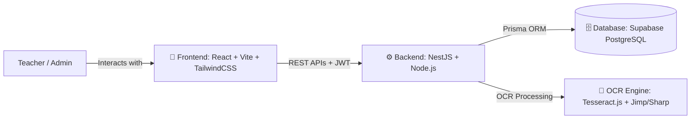

# Scoring Assistant (ប្រព័ន្ធស្វ័យប្រវត្តិកម្មបញ្ចូលពិន្ទុឆ្លាតវៃ)

Scoring Assistant គឺជាប្រព័ន្ធ AI ស្វ័យប្រវត្តិកម្មសម្រាប់ជួយសម្រួលដល់ការបញ្ចូលពិន្ទុ និងគ្រប់គ្រងសិស្ស-ថ្នាក់រៀន ដោយប្រើប្រាស់បច្ចេកវិទ្យា OCR (Optical Character Recognition) ដើម្បីចាប់យកអត្តលេខសិស្ស និងពិន្ទុពីក្រដាសប្រឡងដែលបានស្កេនដោយស្វ័យប្រវត្តិ។

---

## 🏗️ ប្រព័ន្ធស្ថាបត្យកម្មរួម (System Architecture Overview)



---

## 🎨 ១. Frontend (បច្ចេកវិទ្យាផ្នែកខាងមុខ)

ផ្នែក Frontend ត្រូវបានបង្កើតឡើងយ៉ាងទំនើប (Modern UI/UX) ផ្ដោតលើល្បឿន និងភាពងាយស្រួលប្រើប្រាស់សម្រាប់លោកគ្រូ-អ្នកគ្រូ៖

| បច្ចេកវិទ្យា (Technology) | កំណែ (Version) | តួនាទី និងការប្រើប្រាស់ (Role & Usage) |
| :--- | :--- | :--- |
| **React** | `v19` | Library ចម្បងសម្រាប់បង្កើត User Interface បែប Single Page Application (SPA) |
| **Vite** | `v8` | Frontend Build Tool & Dev Server ដែលមានល្បឿនលឿនបំផុត (Lightning-fast HMR) |
| **TypeScript** | `v5+` | ភាសាកូដចម្បងដែលផ្ដល់នូវ Type Safety និងកាត់បន្ថយ Bug |
| **Tailwind CSS** | `v3` | Utility-first CSS Framework សម្រាប់រចនា Interface បែប Glassmorphism ស្រស់ស្អាត |
| **React Router DOM** | `v7` | គ្រប់គ្រង Route ទំព័រទាំងអស់ក្នុងប្រព័ន្ធ (`/students`, `/assessments`, `/verification`...) |
| **Axios** | `v1.20` | HTTP Client សម្រាប់ទាក់ទងជាមួយ Backend API ព្រមទាំងមាន 401 Auto-Auth Interceptors |
| **Lucide React** | Latest | បណ្តុំ Icons ដ៏ស្រស់ស្អាត និងទាន់សម័យទូទាំងប្រព័ន្ធ |
| **Vercel** | Cloud | ទីតាំង Host ផ្នែក Frontend លើអ៊ីនធឺណិត (`duc2026pgbscoring-assistant.vercel.app`) |

---

## ⚙️ ២. Backend (បច្ចេកវិទ្យាផ្នែកខាងក្រោយ)

ផ្នែក Backend ត្រូវបានបង្កើតឡើងតាមស្ថាបត្យកម្មកម្រិតសហគ្រាស (Enterprise-grade Modular Architecture)៖

| បច្ចេកវិទ្យា (Technology) | កំណែ (Version) | តួនាទី និងការប្រើប្រាស់ (Role & Usage) |
| :--- | :--- | :--- |
| **NestJS** | `v12` | Progressive Node.js Framework បែប Modular (Controllers, Services, Modules) |
| **Node.js** | `v20+` | JavaScript/TypeScript Server-side Runtime Environment |
| **TypeScript** | `v5+` | ភាសាសរសេរកូដ Backend ទាំងស្រុងតាមបែប Object-Oriented Programming (OOP) |
| **JWT & Passport** | `v12` | ប្រព័ន្ធសុវត្ថិភាព និង Authentication (JSON Web Tokens) ការពារ API Endpoints |
| **Multer** | Latest | Middleware សម្រាប់គ្រប់គ្រងការ Upload ឯកសារ (រូបភាពក្រដាសប្រឡង, ឯកសារ Excel) |
| **Tesseract.js** | `v7` | AI OCR Engine សម្រាប់អានអក្សរ និងលេខពីក្រដាសប្រឡង (`khm.traineddata` & `eng.traineddata`) |
| **Sharp & Jimp** | Latest | Image Processing សម្រាប់កែច្នៃ បង្កើនកម្រិត Contrast និងកាត់រូបភាពមុនធ្វើ OCR |
| **SheetJS (XLSX)** | Latest | Parser សម្រាប់អាន និងទាញយកទិន្នន័យពី Excel/CSV តាមទម្រង់តារាងកម្ពុជា |
| **Render Cloud** | Cloud | ទីតាំង Host ផ្នែក Backend API លើអ៊ីនធឺណិត (`pgb-scoring-assistant-team2.onrender.com`) |

---

## 🗄️ ៣. Database (ប្រព័ន្ធផ្ទុកទិន្នន័យ)

ប្រព័ន្ធទិន្នន័យត្រូវបានរចនាឡើងយ៉ាងរឹងមាំដើម្បីរក្សាទុកព័ត៌មានសិស្ស ថ្នាក់រៀន មុខវិជ្ជា ពិន្ទុ និងរូបភាពស្កេន៖

| ធាតុផ្សំ (Component) | បច្ចេកវិទ្យា (Technology) | សេចក្ដីលម្អិត និងតួនាទី (Details & Functionality) |
| :--- | :--- | :--- |
| **Database Engine** | **PostgreSQL (v15+)** | ប្រព័ន្ធទិន្នន័យប្រភេទ **Relational Database (SQL)** ដែលមានល្បឿនលឿន សុវត្ថិភាពខ្ពស់ និងអាចទុកទិន្នន័យបានច្រើន |
| **ORM & Migrations** | **Prisma ORM (v5.22)** | គ្រប់គ្រង Database Schema, បង្កើត Migrations និងផ្តល់នូវ Type-safe Database Client |
| **Cloud Database** | **Supabase (PostgreSQL)** | ប្រព័ន្ធ Cloud PostgreSQL Database ដំណើរការលើ Cloud ដោយផ្ទាល់ (មិនបាច់ប្រើ Docker) |

### 📊 តារាងទិន្នន័យចម្បងក្នុង Database (Database Models):
- 🧑‍🎓 **`User`**: រក្សាទុកគណនីគ្រូបង្រៀន និងអ្នកគ្រប់គ្រង (Admin / Teacher)
- 🎒 **`Student`**: រក្សាទុកព័ត៌មានសិស្ស (Student ID, ឈ្មោះ, ភេទ, ថ្នាក់រៀន `class_name`...)
- 📚 **`Subject`**: រក្សាទុកព័ត៌មានមុខវិជ្ជា (គណិតវិទ្យា, រូបវិទ្យា...)
- 📝 **`Assessment`**: រក្សាទុកការប្រឡង (ឈ្មោះការប្រឡង, ពិន្ទុអតិបរមា, កាលបរិច្ឆេទ...)
- 📷 **`ScannedPaper` & `ScanBatch`**: រក្សាទុក File រូបភាពក្រដាសប្រឡងដែលបានស្កេន
- 🎯 **`Grade`**: រក្សាទុកពិន្ទុ និងស្ថានភាពនៃការផ្ទៀងផ្ទាត់ (Pending / Verified)

---

## 💻 ៤. Programming Languages (ភាសាកូដដែលប្រើប្រាស់)

- **TypeScript**: ភាសាស្នូល **៩០%+** នៃគម្រោងទាំងមូល (ប្រើទាំង Frontend និង Backend)
- **JavaScript (ESNext)**: ប្រើប្រាស់សម្រាប់ Configuration, Build Scripts និង Tooling
- **HTML5 & CSS3**: ប្រើប្រាស់សម្រាប់រៀបចំ Layout និង Styling
- **SQL**: ប្រើប្រាស់តាមរយៈ Prisma Schema និង Query ទៅកាន់ PostgreSQL
- **PowerShell**: ប្រើប្រាស់សម្រាប់ Script បញ្ជា Run ប្រព័ន្ធទាំងអស់ (`run-all.ps1`)

---

## 🚀 ការតម្លើង និងដំណើរការប្រព័ន្ធ (Getting Started)

### ១. តម្រូវការជាមុន (Prerequisites)
- [Node.js](https://nodejs.org/) (Version 18 ឬ 20+)
- គណនី [Supabase](https://supabase.com/) សម្រាប់ Database (មិនបាច់ដំឡើង Docker ឡើយ)

### ២. ដំណើរការប្រព័ន្ធដោយស្វ័យប្រវត្តិ (Quick Start)
បើក PowerShell នៅក្នុង Folder គម្រោង រួច Run Command តែមួយគត់៖
```powershell
.\run-all.ps1
```
Script នេះនឹងចាប់ផ្តើមដំណើរការ៖
1. 🗄️ **Supabase Database** (ភ្ជាប់ទៅកាន់ Cloud PostgreSQL ដោយស្វ័យប្រវត្តិ)
2. ⚙️ **Backend NestJS** (Port `3000`)
3. 🎨 **Frontend Vite** (Port `5173`)

### ៣. គណនី Default សម្រាប់ចូលប្រើប្រាស់
- **URL**: `http://localhost:5173/login`
- **Email**: `teacher@example.com`
- **Password**: `password123`
